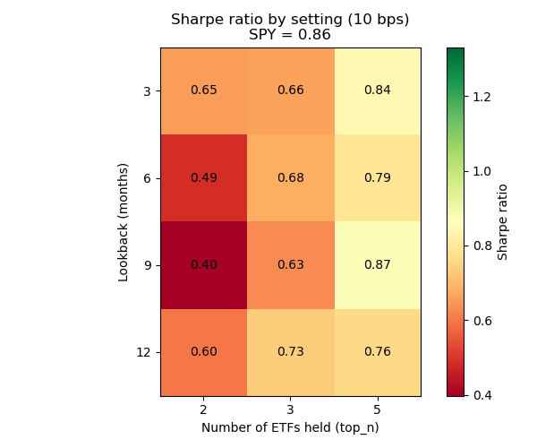
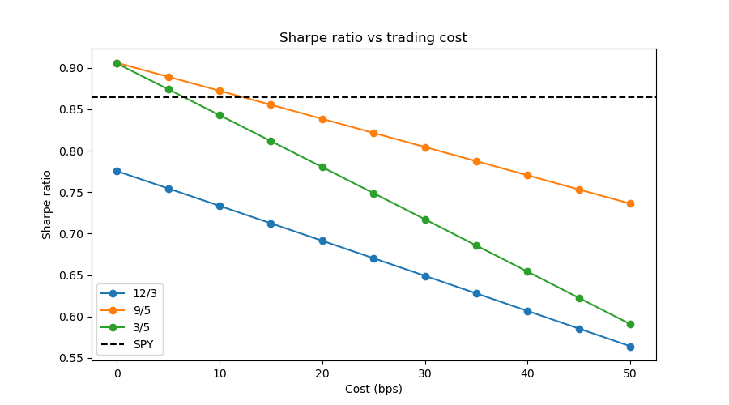
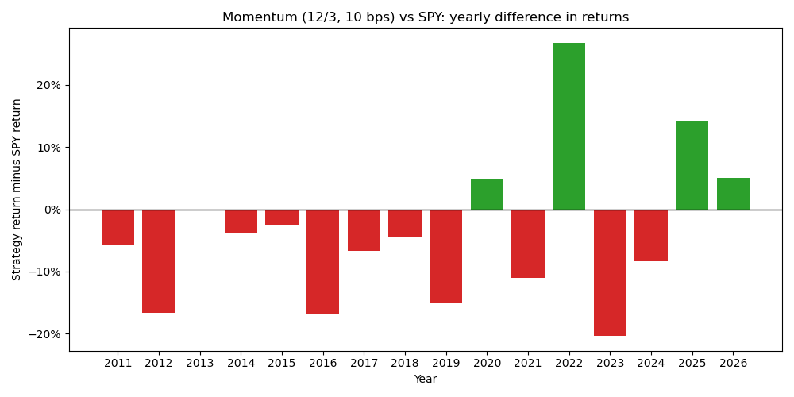

# Cross-Sectional Momentum in Sector ETFs

A research study testing whether ranking ETFs by past returns and holding the winners
beats simply holding the S&P 500, after realistic trading costs.

## Key finding
Over February 2011 to September 2026, cross-sectional momentum across 15 ETFs did **not**
beat buy-and-hold SPY on a risk-adjusted basis (Sharpe 0.73 vs 0.86 after 10 bps costs),
and its alpha was not statistically significant. Its main benefit was lower risk: a
smaller maximum drawdown (−22% vs −34%) and strong protection in 2022. These conclusions
held across parameter settings, time periods, cost assumptions and execution timing.

## Research question
Does cross-sectional momentum outperform buy-and-hold SPY on a risk-adjusted basis across
15 US sector and cross-asset ETFs (2010–present)?

## Data
- Daily adjusted open and close prices from Yahoo Finance via `yfinance`, January 2010 to
  7 October 2026 (end date fixed for reproducibility)
- 15 ETFs: 10 US sector ETFs, plus SPY, IWM, EFA, EEM, TLT and GLD
- Prices adjusted for dividends and splits; empty rows dropped

## Hypotheses (written before backtesting)
1. Most ETFs are highly correlated with SPY, so the strategy will behave much like the
   market most of the time.
2. Any edge will come mainly from reduced losses in long downturns, when low-correlation
   assets like TLT and GLD rank highly.
3. Results may depend heavily on a few key periods.

## Hypotheses: outcome
1. **Partly supported.** Beta is 0.63 and R² is 0.48: the strategy carries clearly less
   market exposure than SPY, as it periodically rotates into less correlated assets.
2. **Partly supported.** It limited losses in some downturns (max drawdown −22% vs −34%,
   and much better in 2022), but had its own long drawdowns in 2011–2013 and 2016–2017,
   and produced no overall edge (Sharpe 0.73 vs 0.86; alpha not significant). Its 2022
   protection came partly from energy, not bonds.
3. **Partly supported.** Its gains were concentrated in a few years, especially 2022, but
   it lagged SPY in 12 of 16 years, so its underperformance was not limited to a few periods.

## Strategy
At each month-end (the last trading day), rank the 15 ETFs by their 12-month return and
hold the top 3 in equal weights until the next month-end.

## Methodology
- **No look-ahead bias:** the backtester applies every decision from the next trading day,
  so a strategy can only use information available at the time. A demonstration in
  `backtest_spy.py` shows how a one-day timing error inflated a backtest from 5.2x to 20.3x.
- **Month-end dates:** decisions are dated on actual last trading days, not calendar
  month-ends, so they line up correctly with daily data.
- **Incomplete months** are dropped, so no decision is based on a partial month.
- **Trading costs** are charged on turnover (the total change in portfolio weights).
- **Fair comparisons:** the strategy and SPY are always evaluated over the same period,
  after the strategy's warm-up.

## Results (Feb 2011 – Sep 2026, 10 bps costs)

| | Momentum | SPY |
|---|---|---|
| CAGR | 10.4% | 14.2% |
| Annualised volatility | 15.1% | 17.0% |
| Sharpe ratio | 0.73 | 0.86 |
| Max drawdown | −22.1% | −33.7% |

- Yearly turnover of 6.4 (roughly 9–10 ETF swaps a year)
- Beta 0.63 (95% CI 0.50–0.76 with Newey–West standard errors), R² 0.48
- Annualised alpha 1.8%, not statistically significant (p = 0.44)


## Robustness checks
- **Parameter sweep:** Sharpe ratios ranged from 0.40 to 0.87 across 12 combinations of
  lookback and number of holdings; only one narrowly beat SPY. Holding more ETFs
  consistently improved results.
- **Out-of-sample:** the best 2011–2018 setting ranked 5th of 12 from 2019 onwards, below
  SPY, so choosing settings from past performance was unreliable.
- **Sub-periods:** the strategy beat SPY in only 4 of 16 years; gains were concentrated in
  difficult markets, especially 2022.
- **Costs:** the best settings' advantage over SPY disappeared at around 6–12 bps.
- **Execution timing:** trading at the next day's open instead of the close changed
  results very little.





## Limitations
- One universe of 15 ETFs and one 15-year period; results may differ elsewhere.
- Costs are a flat rate per trade rather than each ETF's actual bid–ask spread.
- Returns are not adjusted for the risk-free rate.
- Past performance does not guarantee future results.

## How to run
```
pip install -r requirements.txt
python data.py
python -m pytest
```
Then open `research.ipynb` (main analysis) and `robustness.ipynb` (robustness checks).

## Project structure
- `data.py`: downloads and cleans price data
- `explore.py`: summary statistics, growth and correlation charts
- `backtest_spy.py`: 200-day moving average backtest on SPY, demonstrating look-ahead bias
- `metrics.py`: performance metrics (CAGR, volatility, Sharpe, drawdown)
- `backtester.py`: backtesters with built-in look-ahead protection and trading costs
- `momentum.py`: the cross-sectional momentum strategy
- `research.ipynb`: main analysis against SPY
- `robustness.ipynb`: robustness checks
- `tests/`: automated tests for the metrics and backtester
- `figures/`: saved charts
