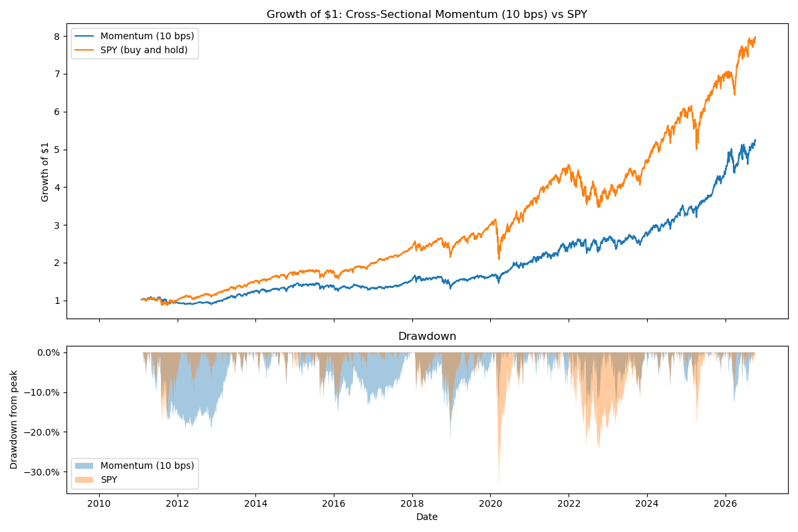

# Cross-Sectional Momentum in Sector ETFs

Research study testing whether ranking ETFs by past returns and holding
the winners beats simply holding the S&P 500, after realistic costs.

## Research question
Does cross-sectional momentum outperform buy-and-hold SPY on a
risk-adjusted basis across 15 US sector and cross-asset ETFs (2010–present)?

## Data
- Daily adjusted closing prices from Yahoo Finance via `yfinance`
- 15 ETFs: 10 US sector ETFs, plus SPY, IWM, EFA, EEM, TLT and GLD
- Prices adjusted for dividends and splits; empty rows dropped

## Hypotheses (written before backtesting)
1. Most ETFs are highly correlated with SPY, so the strategy will
   behave much like the market most of the time.
2. Any edge will come mainly from reduced losses in long downturns,
   when low-correlation assets like TLT and GLD rank highly.
3. Results may depend heavily on a few key periods.

## Hypotheses: outcome
1. **Partly supported.** Beta is 0.63 and R² is 0.48: the strategy carries clearly less
   market exposure than SPY, as it periodically rotates into less correlated assets.
2. **Partly supported.** It limited losses in some downturns (max drawdown −22% vs −34%,
   and much better in 2022), but had its own long drawdowns in 2011–2013 and 2016–2017,
   and produced no overall edge (Sharpe 0.73 vs 0.86; alpha not significant). Its 2022
   protection came partly from energy, not bonds.
3. **Provisionally supported.** The main differences from SPY are concentrated in a few
   periods; tested formally in Phase 6.

## Strategy
At each month-end (last trading day), rank the 15 ETFs by their
12-month return and hold the top 3 in equal weights until the next
month-end. Decisions are applied from the next trading day, and
trading costs are charged on turnover.

## Results so far (Feb 2011 – Sep 2026, 10 bps costs)

| | Momentum | SPY |
|---|---|---|
| CAGR | 10.4% | 14.2% |
| Annualised volatility | 15.1% | 17.0% |
| Sharpe ratio | 0.73 | 0.86 |
| Max drawdown | −22.1% | −33.7% |

- Yearly turnover of 6.4 (roughly 9–10 ETF swaps a year)
- Beta of 0.63 and R² of 0.48 against SPY
- Annualised alpha of 1.8%, not statistically significant (t = 0.75)

## Project structure
- `data.py`: downloads and cleans price data
- `explore.py`: summary statistics, growth and correlation charts
- `backtest_spy.py`: 200-day moving average backtest on SPY, including
  a demonstration of look-ahead bias
- `metrics.py`: performance metrics (CAGR, volatility, Sharpe, drawdown)
- `backtester.py`: reusable backtester with built-in look-ahead
  protection and transaction costs
- `momentum.py`: cross-sectional momentum strategy
- `test.py`: tests checking metrics and the backtester against known results
- `research.ipynb`: analysis and write-up of the momentum strategy
- `figures/`: saved charts

## Status
In progress: momentum strategy evaluated against SPY; robustness
testing (parameter sweeps, out-of-sample tests, significance) next.